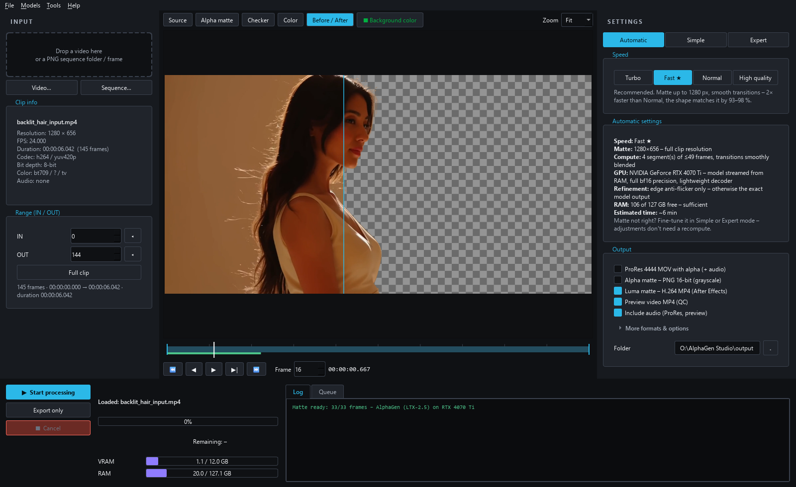
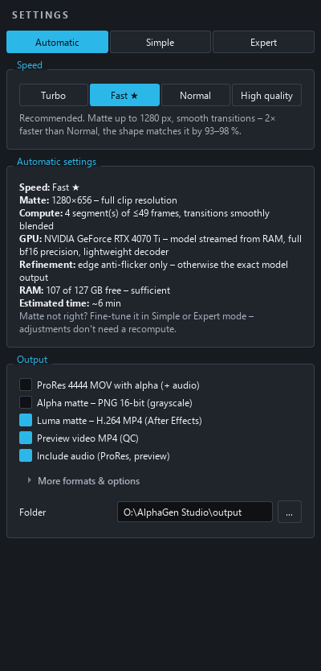
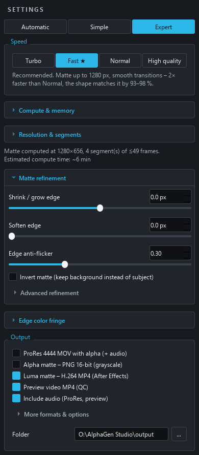
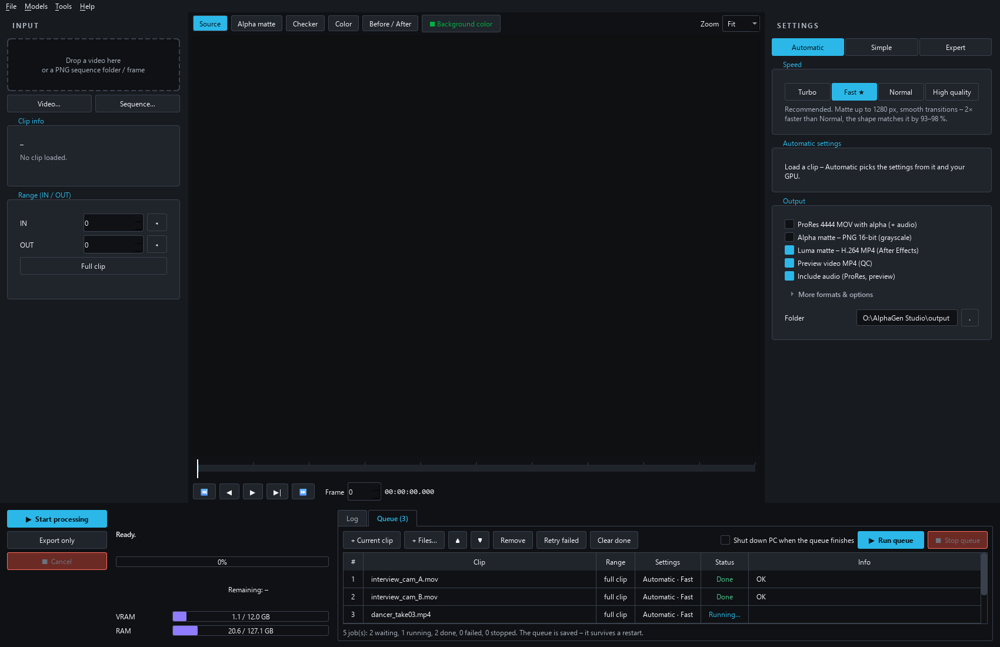
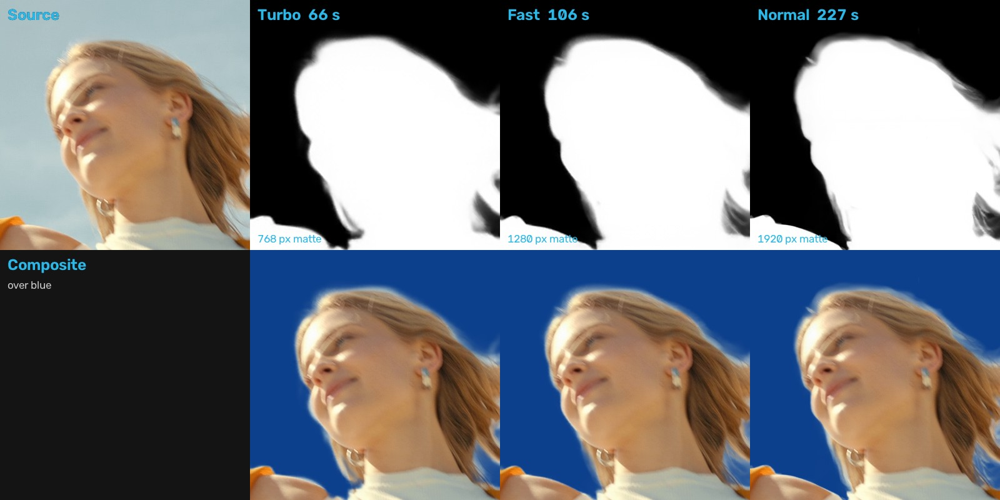
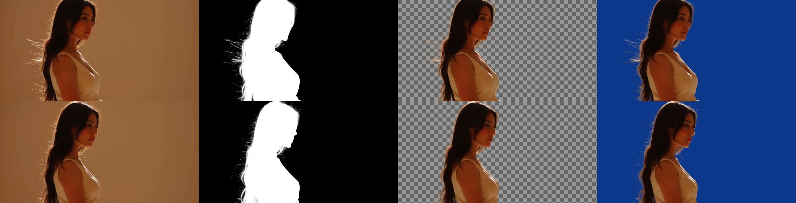
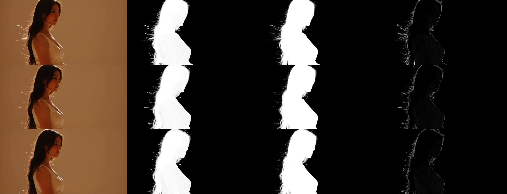

# AlphaGen Studio

AI background removal for video – no green screen – using the official
**Lightricks LTX-2.5 AlphaGen (IC-LoRA)** model. A standalone Windows desktop app
(PySide6 GUI + local inference worker). **No ComfyUI, no cloud** – inference runs on your NVIDIA GPU
with the official [`ltx_pipelines`](https://github.com/Lightricks/LTX-2) code.

The model produces an **alpha matte**; it is applied to the **original RGB** – the image of the
person is never re-generated.



*Before / After view of a real AlphaGen key computed on an RTX 4070 Ti – backlit hair, no green screen
(example footage: Lightricks AlphaGen model card).*

| Automatic mode | Expert mode | Batch queue |
|---|---|---|
|  |  |  |

---

## Quick start (for artists)

1. **Download** this repository (green *Code* button → *Download ZIP*, unzip e.g. to `D:\AlphaGen Studio`)
   or `git clone https://github.com/petroza/AlphaGen-Studio.git`.
2. Install **Python** and **Git** if you don't have them (see Requirements), then run **`setup.bat`** (one time, ~10 min, downloads ~8 GB of Python/PyTorch/CUDA libraries).
3. Run **`start.bat`**. On first start the app offers to download the models (~67 GB, one time):
   - log in at [huggingface.co](https://huggingface.co), open
     [Lightricks/LTX-2.5](https://huggingface.co/Lightricks/LTX-2.5) and
     [Lightricks/LTX-2.5-22b-IC-LoRA-Alpha-Gen](https://huggingface.co/Lightricks/LTX-2.5-22b-IC-LoRA-Alpha-Gen)
     and click **Agree and access repository** on both (LTX-2.x Community License),
   - create a **Read** token at [huggingface.co/settings/tokens](https://huggingface.co/settings/tokens),
   - paste it in **Models → Model Manager** and click **Download missing**
     (also fetches the lightweight VAE that enables Full HD on 12–24 GB cards).
4. Drop a video into the app and press **Start processing**. That's it.

> **Before using it at work:** companies with annual revenues of USD 10M+ need a paid commercial license
> from Lightricks for production use of the models – see [License](#license).

The app starts in **Automatic** mode with the recommended **Fast ★** speed and outputs a
**luma matte H.264 MP4** (for After Effects *Track Matte → Luma*) plus a **preview MP4**.
Nothing else needs to be set – the app detects your GPU and RAM and picks safe settings.

---

## What it does

- Automatic subject separation: people and their movement, hair, motion blur, smoke, sheer fabric.
- **The model picks the foreground itself.** There is no subject selection by click, prompt or mask
  (the official model does not support it).
- Long clips are split into segments of 8n+1 frames (model limit 145, recommended ≤121) with
  overlapping, cross-faded transitions – no visible jumps.
- Resume: finished segments are cached; a stopped or crashed job continues where it left off.
- **Batch queue** for overnight jobs (tab *Queue*): add clips or whole folders, run, optionally shut
  down the PC when finished. The queue survives a restart.

### Speed profiles (measured on RTX 4070 Ti 12 GB, 49 frames)

| Profile | Matte computed at | Time per 49 frames (Full HD source) | ≈ 1 min of 25 fps video | Shape vs Normal | When to use |
|---|---|---|---|---|---|
| Turbo | 768 px | 55–66 s | ~30 min | 89–97 % | quick check of what the model picks |
| **Fast ★** (default) | 1280 px | 103–106 s | ~65 min | 93–98 % | most work |
| Normal | full (up to 1920×1088) | 227 s | ~140 min | reference | final key with fine hair / motion blur |
| High quality | full | ~+20 % vs Normal | | ≈ Normal | longer segment blending, stronger anti-flicker |

For 720p sources Fast and Normal are identical (both compute at full 1280×720).

### Settings modes

- **Automatic** – pick a speed and outputs only. Shows what will be used and an estimated time
  (learned from previous runs on this PC).
- **Simple** – speed + a few edge adjustments.
- **Expert** – everything, in collapsible sections; explanations as hover tooltips.

Matte adjustments (shrink/grow, soften, anti-flicker, levels, edge refinement against the source,
despeckle, invert, background-color decontamination) are real image operations on the model output.
They update live in the viewer and need **no recompute** – use **Export only**.

### Outputs

| Output | Notes |
|---|---|
| **Luma matte – H.264 MP4** (default) | grayscale matte for After Effects *Track Matte → Luma*; 8-bit lossy |
| **Preview MP4** (default) | source | composite on checkerboard, for a quick check |
| ProRes 4444 MOV with alpha | `yuva444p` + audio; alpha is verified by decoding after export |
| Alpha matte – PNG 16-bit | lossless grayscale sequence |
| PNG RGBA sequence | 8-bit source → bit-exact original RGB |
| EXR RGBA (half) | premultiplied (OpenEXR convention), optional linearization |
| Alpha matte – ProRes 422 HQ | grayscale matte for NLEs |

Straight alpha is the default for PNG/ProRes (correct for Premiere/After Effects); EXR is always
premultiplied (Nuke). Sequences are numbered by source frame. Rotation metadata, VFR (converted to CFR),
BT.601/709/2020 color matrices, 10/12-bit sources and audio are handled.

---

## Requirements

- Windows 10/11 x64, **NVIDIA GPU** with a current driver (CUDA 13.2 capable)
- Disk: ~70 GB for models + ~8 GB for the environment
- RAM: 64 GB+ recommended (the model is streamed from RAM on 12–24 GB cards; with ≥96 GB
  the app uses full bf16 precision, which gave a cleaner matte than FP8 at the same speed)
- **Python 3.10+** from [python.org](https://www.python.org/downloads/) (or `winget install Python.Python.3.12`) –
  `setup.bat` uses it only to install [uv](https://docs.astral.sh/uv/), which then manages everything else
- **Git** (`winget install Git.Git`); FFmpeg is installed by `setup.bat` via winget if missing

| GPU | Automatic picks | Status |
|---|---|---|
| RTX 4070 Ti 12 GB | weights streamed from RAM, lightweight VAE, Full HD, 49-frame segments | **verified** |
| RTX 4090 24 GB | same, faster | not verified |
| 40–80 GB (A6000/L40…) | FP8, model fully in VRAM | not verified |
| ≥80 GB (H100, RTX PRO 6000 Blackwell) | bf16, accurate DiffVAE, 121-frame segments | not verified |

Out of VRAM is handled: the job stops cleanly (the worker is a separate process), finished segments
are kept and the app suggests a lower resolution or shorter segment.

---

## How it uses the official model

Recipe from the [AlphaGen docs](https://docs.ltx.io/open-source-model/vfx-post-production/alpha-gen):
`ltx_pipelines.ic_lora`, distilled LTX-2.5 22B, LoRA `ltx-2.5-22b-ic-lora-alpha-gen-0.9` at 1.0,
empty prompt, video conditioning 1.0, `--skip-stage-2` (CLI width/height = 2× the source),
dimensions divisible by 32 with padding (not stretching), frame counts 8n+1.
The worker builds the pipeline with the official CLI argument parser and keeps it loaded between
segments. Two Windows-only fixes are applied at runtime without changing results
(pinned-memory allocation without POSIX `mmap` flags; running under `torch.inference_mode()` like the
official CLI). `setup.bat` installs LTX-2 at the tested commit `f0f2f86`; `setup.bat update` pulls the
latest (untested).

Decoder: the docs use the DiffVAE (`ltx-2.5-video-vae-bf16`), which fits a 12 GB card only up to
~1280 px / 33 frames. Lightricks also ships `ltx-2.5-video-vae-conv-bf16`; against the official
reference it gave the same matte quality (MAE 0.0118 vs 0.0121) at ~30 % less time and enables Full HD on
12 GB. *Automatic* uses it below 40 GB VRAM.

## Command line

```bat
.venv\Scripts\python.exe -m alphagen_studio.cli check
.venv\Scripts\python.exe -m alphagen_studio.cli run clip.mp4 --profile fast --formats matte_h264,preview
.venv\Scripts\python.exe -m alphagen_studio.cli queue      (runs the queue saved in the GUI, no window)
```

## Tests

`run_tests.bat` – ~90 automated tests: frame-accurate decoding (H.264 with B-frames, HEVC, ProRes
10-bit 23.976, PNG sequences), rotation, color matrices, geometry/segmentation for 1–7777 frames,
cross-fade continuity, all export formats incl. decoded ProRes alpha, end-to-end frame sync through the
whole pipeline (with a test worker that is **not AI**), resume, batch queue.
`run_tests.bat -m gpu` runs a real AlphaGen inference (needs models).

## Limitations

- The model decides what the foreground is; ambiguous scenes (e.g. many curtains) can include
  background parts – check with a quick Turbo test.
- Output above 1920×1088 is computed downscaled and upscaled (with optional edge refinement).
- Segments are inferred independently; a hard cut inside a clip can change the chosen subject.
- H.264 luma matte is 8-bit and lossy – use PNG 16-bit or ProRes 4444 for the finest detail.

## Benchmarks

**Test system:** NVIDIA GeForce **RTX 4070 Ti 12 GB** (driver 621.01) · AMD Ryzen 9 7950X3D · 128 GB RAM ·
NVMe SSD · Windows 11 Pro · PyTorch 2.13.0 + CUDA 13.2 · LTX-2 commit `f0f2f86` · measured 2026-11-14/15.
Model weights streamed from RAM (`--offload cpu`), full bf16 precision, lightweight (convolutional) VAE –
i.e. what *Automatic* picks on this machine.

**Speed profiles** – one segment of 49 frames, outputs: luma matte H.264 + 16-bit PNG matte.
*Segment* = AlphaGen inference only; *Total* = whole job incl. worker start, model load, inference
and export (wall-clock).

| Source | Profile | Matte computed at | Segment (49 fr.) | Total job | Peak VRAM |
|---|---|---|---|---|---|
| 1920×1080 | Turbo | 768×432 | 66 s | 108 s | 7.7 GB |
| 1920×1080 | Fast ★ | 1280×720 | 106 s | 147 s | 7.7 GB |
| 1920×1080 | Normal | 1920×1080 | 227 s | 240 s | 9.2 GB |
| 1920×1080 | Turbo | 768×432 | 55 s | 92 s | 7.7 GB |
| 1920×1080 | Fast ★ | 1280×720 | 103 s | 134 s | 7.7 GB |
| 1920×1080 | Normal | 1920×1080 | 227 s | 240 s | 9.2 GB |
| 1280×720 | Turbo | 768×432 | 55 s | 68 s | 7.7 GB |
| 1280×720 | Fast ★ / Normal | 1280×720 | 103 s | 112 s | 7.7 GB |

**Visual comparison** – hair against the sky, Full HD source, frame 24 (top: alpha matte, bottom: composite
over blue; times = one 49-frame segment on the RTX 4070 Ti). Footage © Getty Images.



**Backlit hair** – 1280×656, 33-frame segment, lightweight VAE, ~76 s on the RTX 4070 Ti.
Columns: source · alpha matte · over checkerboard · over blue.



**Against the official Lightricks result** – columns: source · official AlphaGen output (alpha recovered from
their composite) · AlphaGen Studio on the RTX 4070 Ti · absolute difference. Mean alpha error 0.012,
shape IoU 0.961; differences are only in the finest strands.



*Example footage: Lightricks, [AlphaGen model card](https://huggingface.co/Lightricks/LTX-2.5-22b-IC-LoRA-Alpha-Gen).*

**Longer clips** (4 segments, overlap 8, Full-resolution 1280×656 source, ProRes 4444 + PNG matte + preview):
150 frames → **370 s total** (≈ 2.5 s per frame including export), 145 frames → 368 s.
Export itself (blending, matte refinement, ProRes 4444 + PNG + H.264 writing and ProRes alpha verification)
takes roughly 10–20 s per 150 frames at 720p; the rest is inference.

**Decoder / precision on the same card** (1280×656, 33 frames per segment):

| Variant | Segment time | Peak VRAM | Matte vs. official Lightricks result |
|---|---|---|---|
| DiffVAE (as in the docs) | 107 s | 7.7 GB | MAE 0.0121, IoU 0.961 |
| Lightweight convolutional VAE | 76 s | 7.7 GB | MAE 0.0118, IoU 0.961 |
| DiffVAE at 1280 px with 49+ frames, or at 1920 px | – | – | does not fit in 12 GB |
| Full HD, 49 frames, convolutional VAE | 227 s | 9.2 GB | ✔ |

Rule of thumb on an RTX 4070 Ti: **~2 s per frame (Fast, Full HD source)**, ~4.6 s per frame (Normal, Full HD),
~1.1–1.4 s per frame (Turbo). Faster GPUs (RTX 4090, RTX PRO 6000) were not tested.

## Credits

AlphaGen Studio is only a desktop front-end – all the AI work is done by models created by
**[Lightricks](https://www.lightricks.com/)**. Huge thanks to the LTX team for releasing
**LTX-2 / LTX-2.5** and the **AlphaGen IC-LoRA** as open weights, together with the inference code,
documentation and reference examples:

- [LTX-2 – official code](https://github.com/Lightricks/LTX-2) (Apache-2.0)
- [LTX-2.5 model weights](https://huggingface.co/Lightricks/LTX-2.5)
- [LTX-2.5 22B IC-LoRA AlphaGen](https://huggingface.co/Lightricks/LTX-2.5-22b-IC-LoRA-Alpha-Gen)
- [AlphaGen documentation](https://docs.ltx.io/open-source-model/vfx-post-production/alpha-gen)

Also thanks to the projects this app is built on: PyTorch, Hugging Face (hosting and `transformers`),
Google Gemma (text encoder used by LTX-2.5), FFmpeg, Qt / PySide6, OpenCV, OpenEXR and uv.

## License

**AlphaGen Studio** (this repository's code) – © 2026 **Petr Závorka**, released under the **MIT License**
([LICENSE](LICENSE)). The MIT license covers only this application's code.

**Not covered by MIT** – each under its own license, see [THIRD_PARTY_NOTICES.md](THIRD_PARTY_NOTICES.md):

- **LTX-2.5 / AlphaGen model weights** – © Lightricks, **LTX-2.x Community License**
  ([copy](licenses/LTX-2.x-Community-License.txt)). Not included; every user downloads them and accepts the
  license on Hugging Face.
- **LTX-2 inference code** – © Lightricks, Apache-2.0 (installed by `setup.bat`).
- Gemma-based text encoder (Google Gemma terms), FFmpeg, PySide6/Qt (LGPL), PyTorch, OpenCV, OpenEXR …
- Example footage in `docs/` – © Lightricks / © Getty Images.

> ⚠️ **Commercial use of the models:** under the LTX-2.x Community License, organizations with annual
> revenues of **USD 10 million or more** need a **paid commercial license from Lightricks**
> (licensing@ltx.io) for any production use – free use is limited to testing and evaluation in a
> non-production environment and to personal non-commercial use. The MIT license of AlphaGen Studio does
> not change this. Not legal advice – read the full license text.

AlphaGen Studio is an independent project, not affiliated with or endorsed by Lightricks.